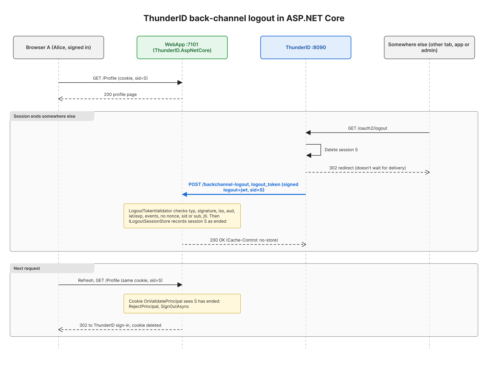

# ThunderID for ASP.NET Core

Sign users in to ASP.NET Core apps with [ThunderID](https://github.com/thunder-id/thunderid), the
open-source IAM stack, and log them out when their ThunderID session ends.

ASP.NET Core already speaks OpenID Connect, so this library doesn't reimplement login. It sets the
options ThunderID needs that differ from ASP.NET Core's defaults, and it adds the one piece ASP.NET
Core doesn't have at all: a receiver for **OIDC back-channel logout**.



## What's in the box

| API | What it does |
|---|---|
| `services.AddThunderID(...)` | Cookie + OpenID Connect sign-in with ThunderID's settings: `response_mode=query`, a nonce within ThunderID's 64-character limit, PKCE, short JWT claim names, a `name` fallback from `given_name` and `family_name`, and an optional RFC 8707 `resource`. Also registers the back-channel logout validator and session store. |
| `app.MapThunderIDBackchannelLogout()` | `POST /backchannel-logout`. Validates ThunderID's `logout_token` and records the session as ended. The next request with that session's cookie is signed out. |
| `services.AddThunderIDApi(...)` | JwtBearer for APIs, keeping claim names as they appear in the token. |
| `AddScopePolicy(name, scopes...)` | Authorization policy for ThunderID's space-delimited `scope` claim, which `RequireClaim("scope", ...)` can't match. |
| `ILogoutSessionStore` | Where ended sessions are kept. In memory by default; register your own to replace it. |

```csharp
// Web app
builder.Services.AddThunderID(options =>
{
    options.Authority = builder.Configuration["ThunderID:Authority"]!;
    options.ClientId = builder.Configuration["ThunderID:ClientId"]!;
    options.ClientSecret = builder.Configuration["ThunderID:ClientSecret"];
});
// ...
app.MapThunderIDBackchannelLogout("/backchannel-logout");

// API
builder.Services.AddThunderIDApi(options =>
{
    options.Authority = builder.Configuration["ThunderID:Authority"]!;
    options.Audience = builder.Configuration["ThunderID:Audience"]!;
});
builder.Services.AddAuthorizationBuilder()
    .AddScopePolicy("billing:read", "billing:read");
```

## Quickstart

This runs the two samples: `samples/WebApp` (Razor Pages, `https://localhost:7101`) and
`samples/Api` (`https://localhost:7102`).

### 1. Prerequisites

- .NET 9 SDK.
- A trusted ASP.NET Core development certificate: `dotnet dev-certs https --trust`.
- **ThunderID built from `main`.** Back-channel logout delivery isn't in a release yet (v1.0.1
  predates it). Build with `pwsh ./build.ps1 build` from a native PowerShell terminal, then unzip
  `target/dist/thunderid-*-win-x64.zip` (or your platform's zip).

### 2. Configure and start ThunderID

1. Add this to the server's `deployment.yaml`. It lets ThunderID deliver logout tokens to
   `localhost`, which it refuses by default. Local development only.
   ```yaml
   oauth:
     logout:
       backchannel:
         reject_private_addresses: false
   ```
2. On a fresh unzip, run `setup.ps1` once with `ADMIN_PASSWORD` set (it generates the keys and
   the admin user), then `start.ps1`. The server listens on `https://localhost:8090`.
3. Trust ThunderID's self-signed certificate, or .NET won't fetch the discovery document
   (`IDX20803 ... UntrustedRoot`). On Windows, for development only:
   ```powershell
   Import-Certificate -FilePath config\certs\server.cert -CertStoreLocation Cert:\CurrentUser\Root
   ```

### 3. Register the web app in the ThunderID console

| Setting | Value |
|---|---|
| Application type | Web application, confidential, with a client secret |
| Grant type | Authorization code, PKCE required |
| Redirect URI | `https://localhost:7101/signin-oidc` |
| Post-logout redirect URI | `https://localhost:7101/signout-callback-oidc` |
| Back-channel logout URI | `https://localhost:7101/backchannel-logout` |
| Client authentication method | **`client_secret_post`** (ASP.NET Core sends the secret in the body, and ThunderID enforces the registered method) |
| Login flow | A flow with an **SSO check and a session step**. Without a session there's no `sid` and nothing to log out |
| Allowed user types | `Person` (this fills the attribute list in the scope mapper) |
| Scope claims | `profile` releases `given_name`, `email` releases `email`, and both are allowed in the ID token |

Create a user to sign in with.

To try the API too, create a resource server with identifier `https://localhost:7102`, a resource
`billing` with an action `read` (the permission is `billing:read`), and a role that grants it.
Assign the role to your user.

### 4. Configure the samples

Set your client ID and secret. Configuration keys use ASP.NET Core's usual sources, so either
user-secrets or environment variables work (`ThunderID:ClientId` becomes `ThunderID__ClientId`).

```powershell
dotnet user-secrets set "ThunderID:ClientId" "<client id>" --project samples/WebApp
dotnet user-secrets set "ThunderID:ClientSecret" "<client secret>" --project samples/WebApp
```

| Key | Project | Default in `appsettings.json` |
|---|---|---|
| `ThunderID:Authority` | WebApp, Api | `https://localhost:8090` |
| `ThunderID:ClientId` | WebApp | the author's test client; replace it |
| `ThunderID:ClientSecret` | WebApp | none, use user-secrets or an environment variable |
| `BillingApi:BaseUrl` | WebApp | `https://localhost:7102`, also sent as the `resource` |
| `ThunderID:Audience` | Api | `https://localhost:7102` |

### 5. Run

```powershell
dotnet run --project samples/Api
dotnet run --project samples/WebApp
```

Open `https://localhost:7101`, sign in, and look at **Claims** and **Call API**. Then end the
session at ThunderID from somewhere else, for example another tab in the same browser opening:

```text
https://localhost:8090/oauth2/logout?client_id=<client id>&post_logout_redirect_uri=https://localhost:7101/signout-callback-oidc
```

Refresh the first tab: you're signed out.

### Tests

```powershell
dotnet test
```

87 tests, no network access. They cover every logout token rejection rule, the session store,
the endpoint (status codes, content type, body cap, `no-store`, cookie revocation) and the scope
policy.

## What I found testing ASP.NET Core against ThunderID

The full log, with times and wording as it happened, is in [FRICTION-LOG.md](FRICTION-LOG.md).
Exact commands and results are in [RUNBOOK.md](RUNBOOK.md).

| Area | Finding | Handled by |
|---|---|---|
| PAR | .NET 9 uses PAR automatically because ThunderID advertises it, and sends the secret in the body | Register the app as `client_secret_post` |
| `response_mode` | ASP.NET Core defaults to `form_post`; ThunderID accepts only `query`, and discovery doesn't say so | `AddThunderID` |
| Nonce | ASP.NET Core's nonce is 115 characters; ThunderID's limit is 64 | `AddThunderID` (62-character nonce) |
| Claim names | `sub` arrives as `.../claims/nameidentifier` and `User.Identity.Name` is null | `AddThunderID` |
| `sid` | Missing unless the app's login flow has a session step | Console configuration |
| Profile claims | Scopes release nothing until the app has scope mappings, ID token attributes and allowed user types | Console configuration |
| Access token `aud` | Comes from the `resource` parameter (RFC 8707) | `ThunderIDOptions.Resource` |
| `scope` claim | One space-delimited string, so `RequireClaim("scope", "billing:read")` always fails | `AddScopePolicy` |
| Back-channel logout | ThunderID delivers a correct, signed `logout+jwt` within a second. ASP.NET Core has no receiver, so the user stays signed in | `MapThunderIDBackchannelLogout` |
| Delivery logs | ThunderID logs a successful delivery only at debug level | Check the receiver's log |

## Limits

- **The default store is in memory and per process.** With more than one instance, a logout
  received by one instance isn't seen by the others, and a restart forgets every logout. Register
  your own `ILogoutSessionStore` backed by a shared cache or database.
- **Logout takes effect on the next request.** The server can't delete a browser's cookie, so the
  cookie is refused the next time it's sent.
- **Access tokens already issued stay valid** until they expire. Back-channel logout ends the
  web app's session; APIs aren't notified.
- **Signature algorithms**: logout tokens are verified with the algorithms ThunderID lists in
  `id_token_signing_alg_values_supported`. This setup was tested with RS256 only.
  Microsoft.IdentityModel 8.19 includes the ML-DSA algorithms, but ML-DSA logout tokens haven't
  been tested.
- **Not supported**: encrypted (JWE) logout tokens, front-channel logout, and embedded
  (app-native) login.

## Repository layout

| Path | Contents |
|---|---|
| `src/ThunderID.AspNetCore` | The library |
| `samples/WebApp` | Razor Pages app: profile, claims, call API, sign-out, back-channel logout |
| `samples/Api` | Minimal API: `/public`, `/me`, `/billing` (needs `billing:read`) |
| `tests/ThunderID.AspNetCore.Tests` | xUnit tests |
| `docs/backchannel-logout.png` | The sequence diagram above (`.drawio` source alongside) |
| `docs/blog` | Article draft, screenshots and captures |
