# I Connected ASP.NET Core to ThunderID. Here's What Actually Happened

ThunderID has 26 SDKs and guides on its docs site. React, Vue, Next.js, Flutter, Spring, Go and
more. I went through the list twice. None of them is for .NET.

I write a lot of C#, so that bothered me. Is it because .NET doesn't need one? ASP.NET Core
already knows how to do OpenID Connect (OIDC) login out of the box. In theory, you point it at
any identity provider and it works.

"In theory" is the part I wanted to test. So I built a small ASP.NET Core app and a small API,
connected both to ThunderID, and wrote down every place I got stuck.

## What I set out to test

- Can a normal ASP.NET Core web app sign users in with ThunderID, using only Microsoft's own packages?
- Can an ASP.NET Core API accept ThunderID access tokens and check scopes?
- What happens when a user's session ends in ThunderID? Does my app find out?

That last question turned out to be the interesting one.

Short version, if you're in a hurry: sign-in works with Microsoft's packages after two small
code changes and some console settings. APIs need a different scope check than the obvious one.
And when a session ends in ThunderID, ThunderID tells your app within milliseconds, but ASP.NET
Core has nothing that listens. So I built the listener. Everything is in a small library,
`ThunderID.AspNetCore`, on GitHub: https://github.com/pasindubalasooriya/thunderid-aspnetcore

## First surprise: no release can do this yet

The feature I cared most about is OIDC back-channel logout. When a session ends at the identity
provider, the provider sends a signed message straight to each app's server so the app can end
its own session too. I'll explain it properly later. For now, all that matters is that ThunderID
added it recently.

How recently? I checked before downloading anything.

```text
$ gh release list -R thunder-id/thunderid --limit 3
ThunderID v1.0.1    Latest    2026-08-25
ThunderID v1.0.0              2026-08-15
ThunderID v1.0.0-rc           2026-08-13

$ git log -1 --format="%h %ad %s" --date=short 95db6efb5
95db6efb5 2026-10-04 Wire OIDC back-channel logout delivery and advertise it in discovery
```

The latest release came out on 25 August. Back-channel logout was merged on 4 October. So if you
download ThunderID from the releases page today, you get a server that can't send these
messages at all. I didn't want to find that out halfway through, so I built ThunderID from the
`main` branch instead.

If you follow along before the next release ships, you'll need to do the same. I kept it in a
separate git worktree so it didn't touch my other ThunderID checkout:

```bash
git fetch upstream
git worktree add ../thunderid-main upstream/main --detach
cd ../thunderid-main
pnpm install --frozen-lockfile
pwsh ./build.ps1 build
```

The build took about 20 minutes on my laptop, and the server ends up zipped in `target/dist`. One
thing that confused me for a second: the zip is still named `thunderid-1.0.0-win-x64.zip`, and
`version.txt` inside says `v1.0.0`. The version number doesn't change on `main`, so you can't tell
from the name whether a build has the feature. Check the commit instead.

## Getting ThunderID running

The docs offer a shortcut: `start.ps1 --bootstrap-and-serve --admin-password ...`, which is meant
to replace the separate setup and start steps. I tried it on a fresh unzip and it failed straight
away:

```text
[INFO] Running ThunderID bootstrap ...
[ERROR] Bootstrap failed.
level=ERROR msg="Failed to read file content" ... config\certs\crypto.key: The system cannot find the file specified.
level=ERROR msg="Failed to load configurations" error="one or more file path substitutions failed"
```

ThunderID generates its own TLS, JWT signing and encryption keys, so every deployment has unique
key material. That's the right design. But only `setup.ps1` generates them. On a first run,
`config/certs/` is empty, and the shortcut has nothing to load. Running setup once and then start
worked fine:

```powershell
$env:ADMIN_PASSWORD = '<your password>'
.\setup.ps1
.\start.ps1
```

Before starting, I made one config change. By default, ThunderID refuses to send back-channel
logout messages to `localhost` or private IP addresses. That's a sensible protection against
SSRF (server-side request forgery) in production. But my app is going to run on
`https://localhost:7101`, so for local development I turned it off in `deployment.yaml`:

```yaml
oauth:
  logout:
    backchannel:
      reject_private_addresses: false
```

The shipped `deployment.yaml` has no `oauth:` section at all, so you add the whole nesting
yourself.

With the server up, the discovery document confirmed the build had what I needed:

```json
{
  "issuer": "https://localhost:8090",
  "end_session_endpoint": "https://localhost:8090/oauth2/logout",
  "backchannel_logout_supported": true,
  "backchannel_logout_session_supported": true,
  "id_token_signing_alg_values_supported": ["RS256", "ES256"]
}
```

`backchannel_logout_supported: true` was the line I was looking for. Note that the discovery
document lives at the root (`/.well-known/openid-configuration`), not under `/oauth2/` like the
other endpoints. That's exactly what ASP.NET Core expects from an `Authority`, so it works in our
favour.

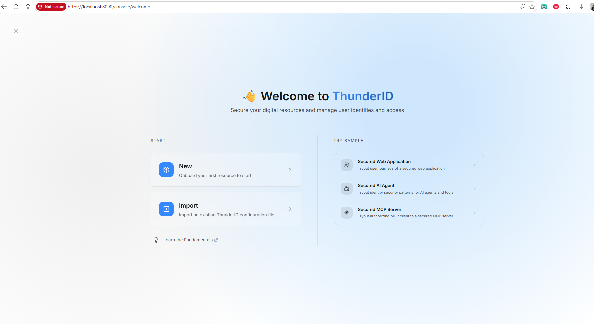

## Registering the app

Next I created a test user, `alice`, and registered the ASP.NET Core app in the console. These
are the values I was aiming for:

| Field | Value |
|---|---|
| Name | `aspnet-webapp` |
| Type | Web application, confidential, with a client secret |
| Grant type | Authorization code, PKCE required |
| Redirect URI | `https://localhost:7101/signin-oidc` |
| Post-logout redirect URI | `https://localhost:7101/signout-callback-oidc` |
| Back-channel logout URI | `https://localhost:7101/backchannel-logout` |
| Scopes | `openid profile email` |

`/signin-oidc` and `/signout-callback-oidc` aren't random. They're the default callback paths
ASP.NET Core's OpenID Connect handler listens on, so if you register them exactly like this, you
don't have to configure them in code. `/backchannel-logout` is different. Nothing in ASP.NET
Core listens there yet. That's the endpoint I'm going to build.

My first attempt didn't go to plan. The app was saved as a machine-to-machine client, with only
the `client_credentials` grant and none of my redirect URIs. I'm honestly not sure whether I
picked the wrong template or whether the values got lost along the way. Either way, ThunderID
told me clearly when I tried to sign in:

```text
/gate/error?errorCode=invalid_request&errorMessage=Invalid+redirect+URI
```

So check what was actually saved before you write any code. Editing the app fixed it, and the
client ID stayed the same, so nothing else had to change.

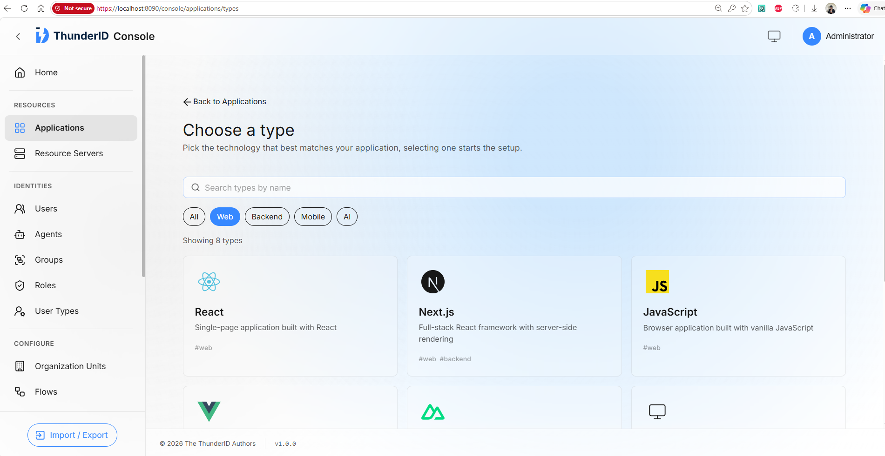

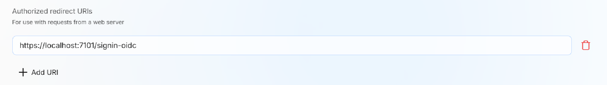

The field I cared about most was the back-channel logout URI. The console accepted
`https://localhost:7101/backchannel-logout` without complaint. That's thanks to the
`reject_private_addresses: false` setting from earlier. The console even warns about it right
under the field: "By default the server refuses localhost and private network addresses." I
like that the warning sits exactly where you'd hit the problem.

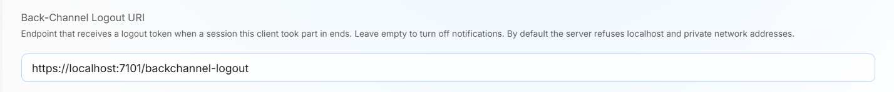

## It worked, after four fixes

My plan for the first sign-in was simple: use only Microsoft's own package,
`Microsoft.AspNetCore.Authentication.OpenIdConnect`, and change nothing I didn't have to. This
is the setup I started with:

```csharp
builder.Services
    .AddAuthentication(options =>
    {
        options.DefaultScheme = CookieAuthenticationDefaults.AuthenticationScheme;
        options.DefaultChallengeScheme = OpenIdConnectDefaults.AuthenticationScheme;
    })
    .AddCookie()
    .AddOpenIdConnect(options =>
    {
        options.Authority = builder.Configuration["ThunderID:Authority"];
        options.ClientId = builder.Configuration["ThunderID:ClientId"];
        options.ClientSecret = builder.Configuration["ThunderID:ClientSecret"];
        options.ResponseType = "code";
        options.SaveTokens = true;
        options.Scope.Add("email");
    });
```

I also added a `/claims` page that prints every claim ASP.NET Core stores, plus the decoded ID
token. Then I clicked it. It took four attempts to get past the first click.

### 1. .NET didn't trust ThunderID's certificate

```text
IDX20803: Unable to obtain configuration from: 'https://localhost:8090/.well-known/openid-configuration'
... The remote certificate is invalid because of errors in the certificate chain: UntrustedRoot
```

ThunderID generates a self-signed TLS certificate on setup. My browser let me click through the
warning, but .NET's `HttpClient` won't. For local development I trusted the certificate for my
user account:

```powershell
Import-Certificate -FilePath .\config\certs\server.cert -CertStoreLocation Cert:\CurrentUser\Root
```

### 2. The client secret was in the "wrong" place

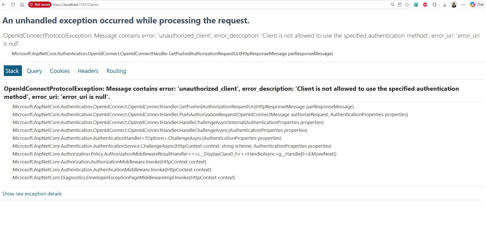

This one confused me, because the stack trace mentioned `PushAuthorizationRequest`, and I never
asked for PAR (pushed authorization requests). It turns out .NET 9 uses PAR automatically when
the provider's discovery document lists a PAR endpoint. ThunderID's does. So the very first thing
ASP.NET Core does is a server-to-server POST, and it sends the client secret in the form body.

The console had registered my app with `client_secret_basic`, which means the secret goes in an
`Authorization` header, and ThunderID strictly accepts only the registered method. I confirmed it
with curl: secret in the body failed, secret in a Basic header worked. Changing one dropdown in
the console fixed it:

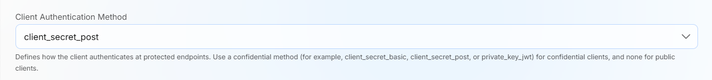

### 3. ThunderID doesn't support form_post

The next error looked almost the same, so at first I thought the fix hadn't worked. Reading it
properly, the message had changed:

```text
invalid_request: Unsupported response_mode parameter
```

ASP.NET Core asks for `response_mode=form_post` by default. ThunderID only accepts `query`, and
its discovery document doesn't list `response_modes_supported`, so there's no way for a client to
find out in advance. This was the first line of code I had to add:

```csharp
options.ResponseMode = "query";
```

### 4. The nonce was too long

Same exception again, different message:

```text
invalid_request: nonce exceeds maximum allowed length
```

ThunderID limits `nonce` to 64 characters. ASP.NET Core's default nonce is 115: a timestamp, a
dot, and two GUIDs in base64. The OIDC spec doesn't set a limit, so neither side is wrong. They
just don't agree. I kept .NET's format, because .NET checks the timestamp part when the response
comes back, and only made the random part shorter:

```csharp
class ShortNonceProtocolValidator : OpenIdConnectProtocolValidator
{
    public override string GenerateNonce() =>
        DateTime.UtcNow.Ticks.ToString(CultureInfo.InvariantCulture) + "." +
        Base64UrlEncoder.Encode(RandomNumberGenerator.GetBytes(32));
}
```

That's 62 characters. Set it as `options.ProtocolValidator`, and keep the two defaults the handler
normally sets on its own validator (`RequireStateValidation = false` and a 15 minute
`NonceLifetime`).

A tip from this part: if you hit an error like this, don't keep restarting and clicking. I
pointed a second copy of the app at a tiny local listener, recorded the exact request ASP.NET
Core sends, and replayed it against ThunderID with curl. That runs every check in one go, instead
of finding them one sign-in at a time.

### Finally, a sign-in page

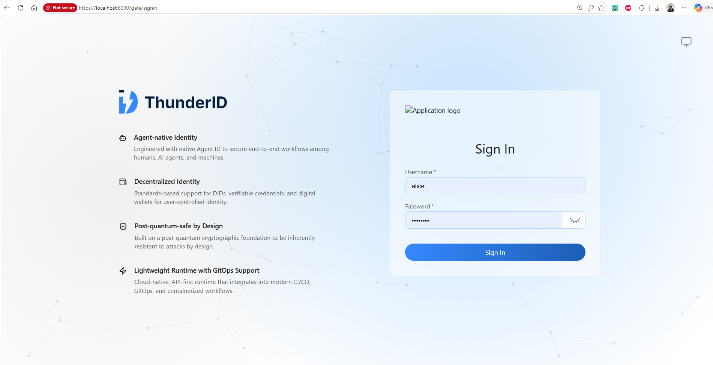

Alice signed in, and I landed back on my `/claims` page:

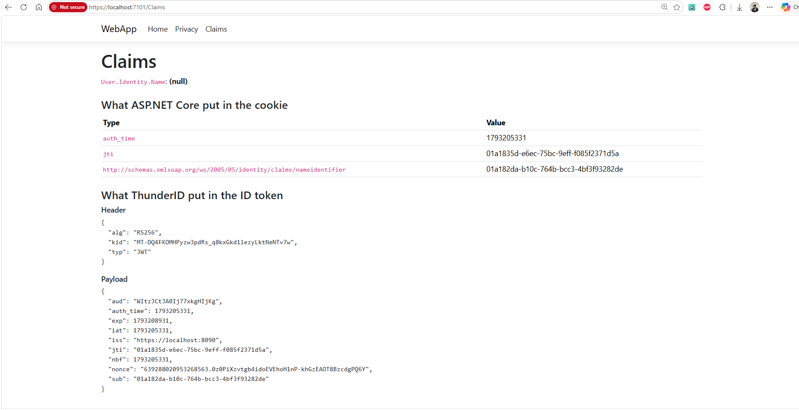

It works, but look at what I actually got:

- `User.Identity.Name` is `null`.
- `sub` has been renamed to `http://schemas.xmlsoap.org/ws/2005/05/identity/claims/nameidentifier`.
  That's ASP.NET Core mapping JWT claim names to old WS-Federation names by default.
- There's no `name` or `email`, even though I asked for the `profile` and `email` scopes. The
  app's scope-to-claim mapping in ThunderID was empty, so those scopes released nothing.
- And there's no `sid`.

That last one matters most for this project. `sid` is the session ID. A back-channel logout
message says "session X has ended", and without a `sid` in the ID token, my app has no idea which
session X is. I'll dig into why it's missing next.

## Where `sid` comes from

I went into ThunderID's source to find out. The `sid` claim is copied from the session that the
login flow creates. And the flow only creates a session if it has a **session step** in it.

New apps get the Default Authentication Flow. It checks the password and issues tokens, but it
has no session step. The console's own login flow has two extra steps: an SSO check at the start
and a session step after the password. So the console gets single sign-on and session tracking,
and a new app gets neither.

The fix was to build a login flow with those two steps, and assign it to my app. While I was
there, I also fixed the missing `name` and `email`. That took two more settings than I expected:

- The app needs **allowed user types**. Mine had none, because it started life as a
  machine-to-machine app. Without a user type, the scope mapper only offers system attributes like
  `ouId` and `roles`, not `given_name` or `email`.
- Each scope needs its attributes mapped, and the ID token needs those attributes allowed. An empty
  mapping doesn't fall back to the standard OIDC claims. It releases nothing.

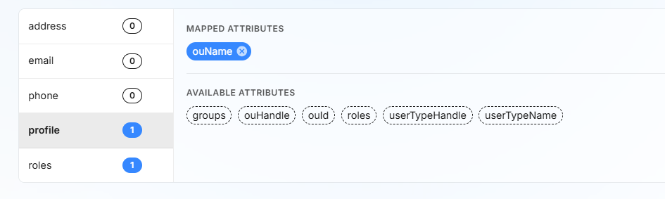

After that, the next sign-in finally had everything:

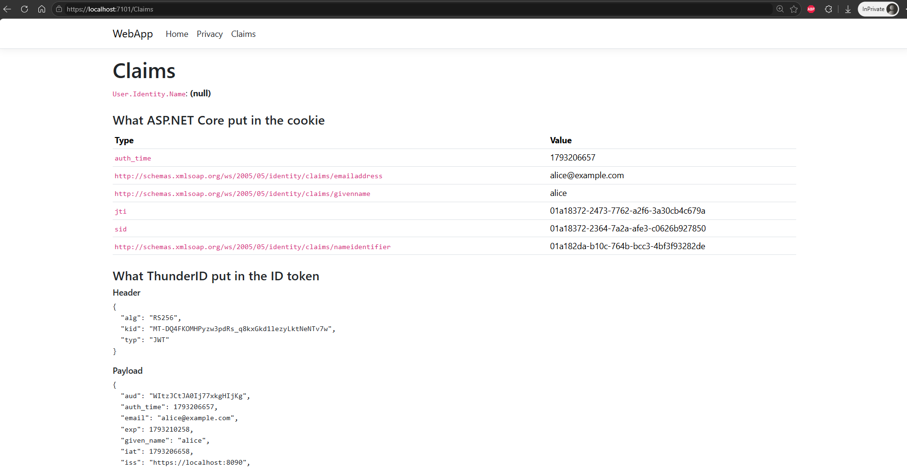

```json
{
  "aud": "WItzJCtJA0Ij77xkgHIjKg",
  "email": "alice@example.com",
  "given_name": "alice",
  "iss": "https://localhost:8090",
  "sid": "01a18372-2364-7a2a-afe3-c0626b927850",
  "sub": "01a182da-b10c-764b-bcc3-4bf3f93282de"
}
```

I also checked ThunderID's database. There's now an SSO session with that ID, and my app is
listed as a participant in it. That participant list is exactly who ThunderID will notify when
the session ends. So for the first time, there's something to log out from.

ASP.NET Core still renames `email` and `given_name` to long XML schema URIs, and
`User.Identity.Name` is still `null`. I'll clean that up later. First I want to see if ThunderID
actually sends the logout message.

## The message nobody was listening for

Here's back-channel logout in one picture. Think of a theme park with one wristband that gets
you into every ride. Each ride has its own staff who check your wristband once, then let you
come and go. If the park cancels your wristband at the main gate, the rides don't know. You can
keep riding until someone tells them. Back-channel logout is the main gate phoning every ride
directly: "wristband 01a18372 is cancelled."

In OIDC terms, the main gate is ThunderID, the rides are apps like mine, and the phone call is
a signed JWT called a logout token. ThunderID POSTs it straight to each app's server, not through
the user's browser. That's why it's called the back channel.

Here's the whole thing as I ended up building it. The rest of this article fills in each arrow.

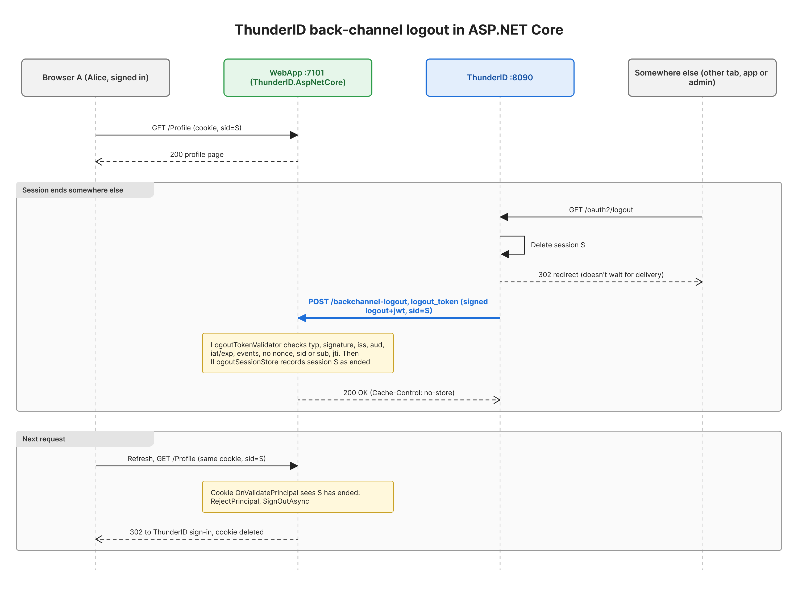

ASP.NET Core doesn't have anything that receives this call. So before writing any real code, I
wanted to know one thing: does ThunderID actually make the call? I added a temporary endpoint at
`/backchannel-logout` that just writes whatever arrives to a file:

```csharp
app.MapPost("/backchannel-logout", async (HttpContext context, ILogger<Program> logger) =>
{
    using var reader = new StreamReader(context.Request.Body);
    var body = await reader.ReadToEndAsync();
    logger.LogWarning("Back-channel probe: POST {ContentType} {Length} bytes: {Body}",
        context.Request.ContentType, body.Length, body);
    return Results.Ok();
});
```

Then, with Alice signed in, I opened ThunderID's end-session endpoint in the same browser
window:

```text
https://localhost:8090/oauth2/logout?client_id=WItzJCtJA0Ij77xkgHIjKg
    &post_logout_redirect_uri=https://localhost:7101/signout-callback-oidc
```

There was no confirmation page. ThunderID ended the session and sent me straight back to my app,
which showed a blank page at `/signout-callback-oidc` because nothing in my app handles that
moment nicely yet.

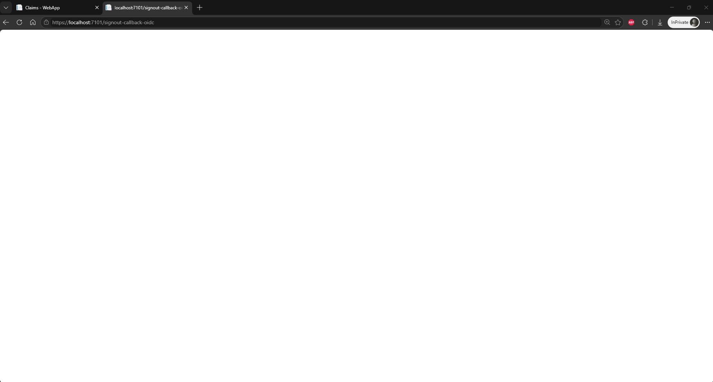

In the same second, my probe got this:

```text
17:06:24.43 application/x-www-form-urlencoded logout_token=eyJhbGciOiJSUzI1NiIsImtpZCI6I...
```

I was honestly relieved. I'd half expected a TLS error, since ThunderID had to call my app on
`https://localhost` with ASP.NET Core's development certificate. It just worked. Decoded, the
token looks like this:

```json
{
  "alg": "RS256",
  "typ": "logout+jwt"
}
{
  "iss": "https://localhost:8090",
  "aud": "WItzJCtJA0Ij77xkgHIjKg",
  "sub": "01a182da-b10c-764b-bcc3-4bf3f93282de",
  "sid": "01a18372-2364-7a2a-afe3-c0626b927850",
  "events": { "http://schemas.openid.net/event/backchannel-logout": {} },
  "jti": "01a1837a-2b97-7ae9-8a16-c421cd2ae7bc",
  "iat": 1793207184,
  "exp": 1793207304
}
```

I checked it against the spec field by field. `typ` is `logout+jwt`. The `sid` is the exact
session ID from Alice's ID token. The `events` claim marks it as a logout event. It's valid for
120 seconds. There's no `nonce`, which the spec requires, so a logout token can never be passed
off as an ID token. The signature verified against ThunderID's JWKS with the same key that signed
the ID token. ThunderID's side of this is done properly.

Then I went back to my app and refreshed:


Still signed in. Same `sid`. ThunderID did its job: the session is gone from its database, and
it told my app about it within a second. My app said "200 OK" and carried on as if nothing had
happened. That's the gap this whole project is about.

One small thing that tripped me up: ThunderID's log was completely silent during all this. A
successful delivery is only logged at debug level. A failed one shows up as a warning. So at the
default log level, no news is good news, but you can't use ThunderID's log alone to confirm that
a delivery worked.

## Sign-out, and why the order matters

Next I built the pages a real app needs: a home page that knows whether you're signed in, a
profile page, and a sign-out button.

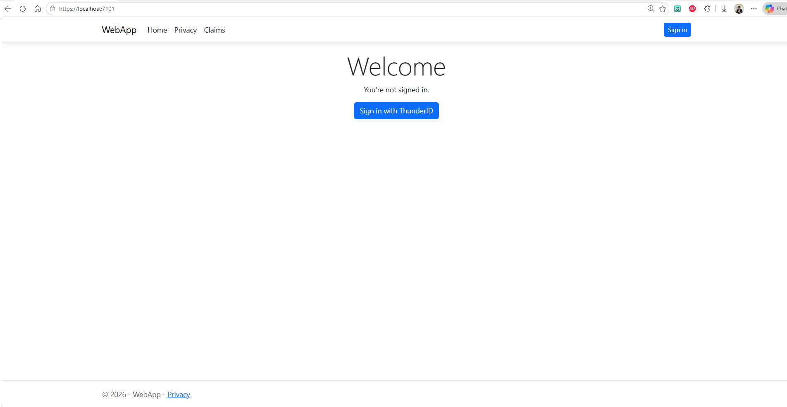

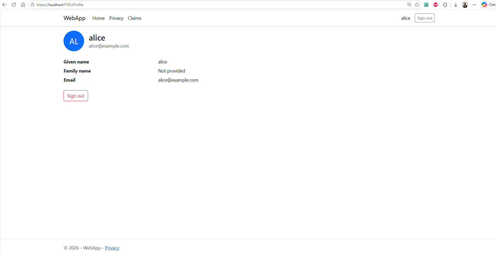

Alice has no family name in ThunderID, so the avatar falls back to the first two letters of her
given name. Small thing, but a profile page that says "?" looks broken.

Sign-out was the one part that worked first time. ASP.NET Core can sign out of two schemes at
once, and the order you list them in matters:

```csharp
public IActionResult OnPost() =>
    SignOut(new AuthenticationProperties { RedirectUri = "/" },
        CookieAuthenticationDefaults.AuthenticationScheme,
        OpenIdConnectDefaults.AuthenticationScheme);
```

The cookie scheme deletes my app's own session cookie. The OpenID Connect scheme then sends the
browser to ThunderID's end-session endpoint, which ends the SSO session and redirects back.

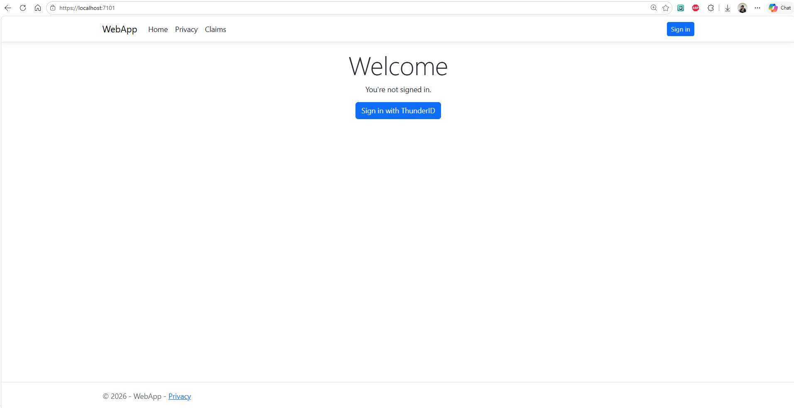

Why clear the cookie first, when ThunderID is about to send a back-channel logout anyway? Because
ThunderID doesn't wait for those deliveries before it redirects you back. I could see this in the
logs. ThunderID finished the logout at 11:49:23.457. My probe received the logout token at
11:49:23.520, about 60 milliseconds later. By then, the browser could already be on its way back
to my app. If the app relied on the back-channel message to end its own session, there would be
a short window where you'd come back to a page that still thinks you're signed in.

That second logout token was also a small surprise. My app started the logout, so it already
knew. ThunderID notified it anyway. The spec says that's correct: every app in the session gets
the message, including the one that asked. It means a receiver has to be fine getting a logout
for a session it already ended, and answer 200 rather than an error.

## The scope that was there but didn't count

Signing in is half the story. The other half is an API that accepts ThunderID's access tokens.
I built a tiny billing API with three endpoints: `/public` for anyone, `/me` for any valid
token, and `/billing`, which should need a `billing:read` scope.

Again, I started with only Microsoft's package and the most obvious code:

```csharp
builder.Services
    .AddAuthentication(JwtBearerDefaults.AuthenticationScheme)
    .AddJwtBearer(options =>
    {
        options.Authority = "https://localhost:8090";
        options.Audience = "https://localhost:7102";
    });

builder.Services.AddAuthorizationBuilder()
    .AddPolicy("billing:read", policy => policy.RequireClaim("scope", "billing:read"));
```

### Getting the scope into the token

Before any of that could work, ThunderID had to know about the API. That meant four things in
the console, and I got one of them wrong the first time:

1. A **resource server** called `billing-api`, whose identifier is the API's URL.
2. A **resource** `billing` with an **action** `read`. ThunderID joins them into the permission
   `billing:read`. I only added the resource at first, which gave me a permission called
   `billing`. Close, but not the same thing.
3. A **role** that grants `billing:read`.
4. Alice **assigned** to that role.

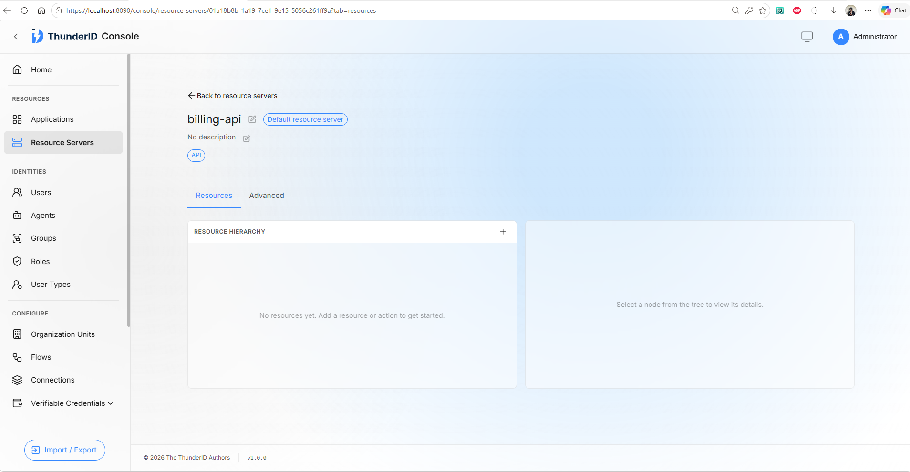

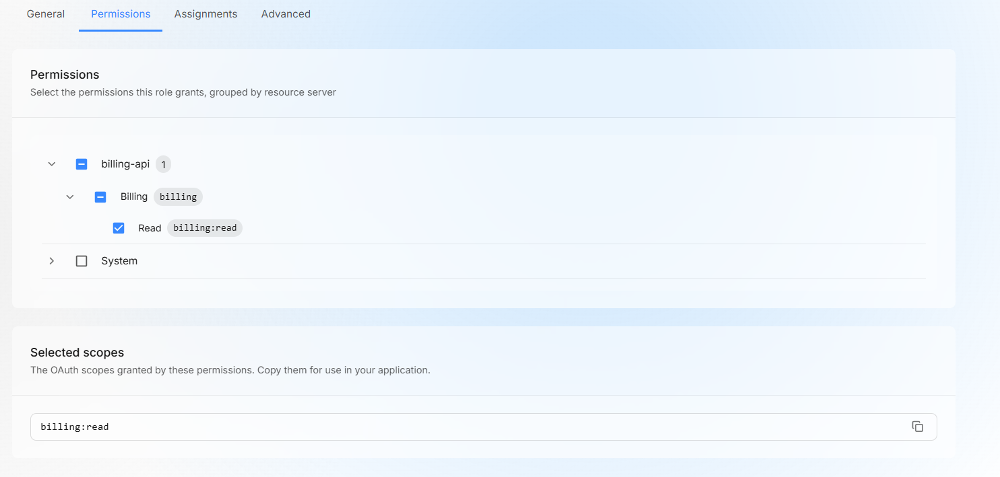

The role step surprised me in a good way. ThunderID doesn't just hand out whatever scope an app
asks for. During login it checks whether the user actually holds that permission through a role,
and quietly drops the scope if not. So the scope in the token really means "Alice is allowed to
read billing", not "the app asked nicely".

On the app side, I added the scope and told ThunderID which API the token is for, using the
`resource` parameter from RFC 8707:

```csharp
options.Scope.Add("billing:read");
options.Resource = "https://localhost:7102";
```

That `resource` line decides the token's audience. The access token came back with exactly what I
wanted:

```json
{
  "aud": "https://localhost:7102",
  "iss": "https://localhost:8090",
  "scope": "openid profile email billing:read",
  "sub": "01a182da-b10c-764b-bcc3-4bf3f93282de"
}
```

### And then a 403

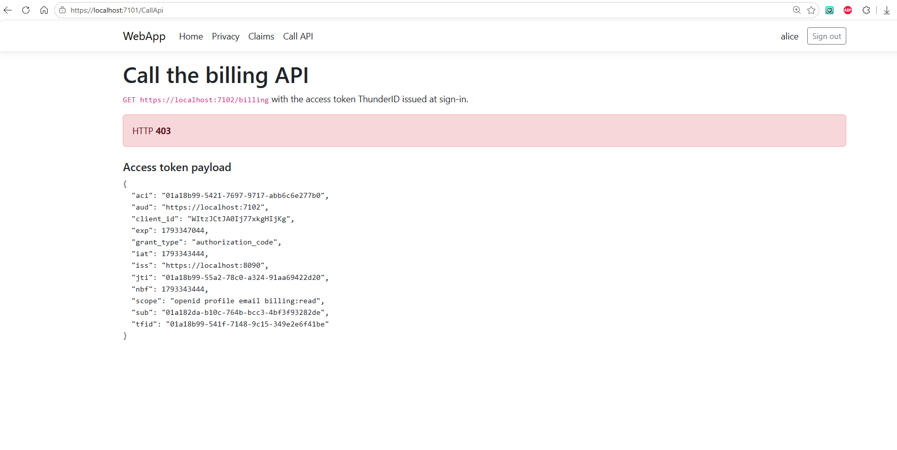

The token was valid. The audience was right. `billing:read` was right there in the `scope`
claim. And the API said 403 Forbidden.

To see why, I asked the API to print the claims it had built from the token:

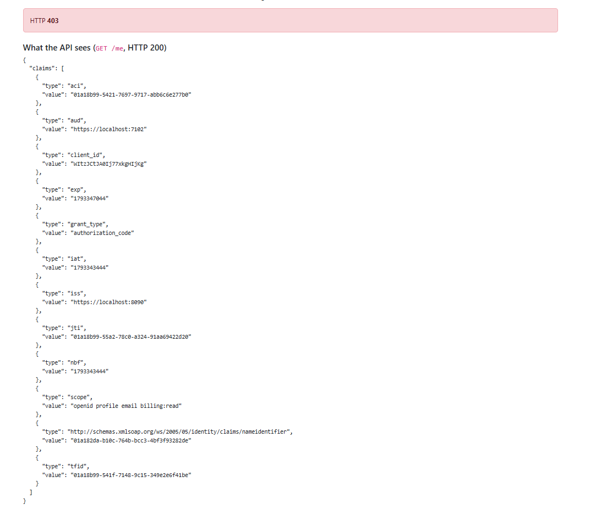

```json
{ "type": "scope", "value": "openid profile email billing:read" }
```

That's one claim, holding one string with four scopes in it. This is the standard OAuth format:
RFC 8693 and RFC 9068 both define `scope` as a space-separated string. ASP.NET Core's JWT handler
keeps it as a single claim and doesn't split it. And `RequireClaim("scope", "billing:read")`
compares the whole value. Is `"openid profile email billing:read"` equal to `"billing:read"`? No.
So the policy fails, every time, for every user.

It's an easy mistake, because the code reads like it should work. It also fails safe, which is
good: you get a 403, not an open API. But it means the first thing every ASP.NET Core API needs
against ThunderID is a scope check that splits the string. I'll write that next.

## Thirty-three lines down to eight

By now I had a list of things ASP.NET Core needs before it plays well with ThunderID. Some were
fixes for real errors, and some just made the claims usable. I moved all of them into a small
library, `ThunderID.AspNetCore`, so an app doesn't have to rediscover them.

Here's the WebApp's sign-in setup before, with every fix done by hand:

```csharp
builder.Services
    .AddAuthentication(options =>
    {
        options.DefaultScheme = CookieAuthenticationDefaults.AuthenticationScheme;
        options.DefaultChallengeScheme = OpenIdConnectDefaults.AuthenticationScheme;
    })
    .AddCookie()
    .AddOpenIdConnect(options =>
    {
        options.Authority = builder.Configuration["ThunderID:Authority"];
        options.ClientId = builder.Configuration["ThunderID:ClientId"];
        options.ClientSecret = builder.Configuration["ThunderID:ClientSecret"];
        options.ResponseType = "code";
        options.ResponseMode = "query";
        options.ProtocolValidator = new ShortNonceProtocolValidator
        {
            RequireStateValidation = false,
            NonceLifetime = TimeSpan.FromMinutes(15),
        };
        options.SaveTokens = true;
        options.Scope.Add("email");
        options.Scope.Add("billing:read");
        options.Resource = builder.Configuration["BillingApi:BaseUrl"];
    });

// plus the ShortNonceProtocolValidator class
```

And after:

```csharp
builder.Services.AddThunderID(options =>
{
    options.Authority = builder.Configuration["ThunderID:Authority"]!;
    options.ClientId = builder.Configuration["ThunderID:ClientId"]!;
    options.ClientSecret = builder.Configuration["ThunderID:ClientSecret"];
    options.Scopes.Add("billing:read");
    options.Resource = builder.Configuration["BillingApi:BaseUrl"];
});
```

The "after" version also does two things the "before" version didn't. It turns off ASP.NET Core's
claim type mapping, so `email` stays `email` instead of becoming
`http://schemas.xmlsoap.org/ws/2005/05/identity/claims/emailaddress`. And when ThunderID sends no
`name` claim, it builds one from `given_name` and `family_name`, so `User.Identity.Name` finally
has a value. Compare this with the claims page from earlier:

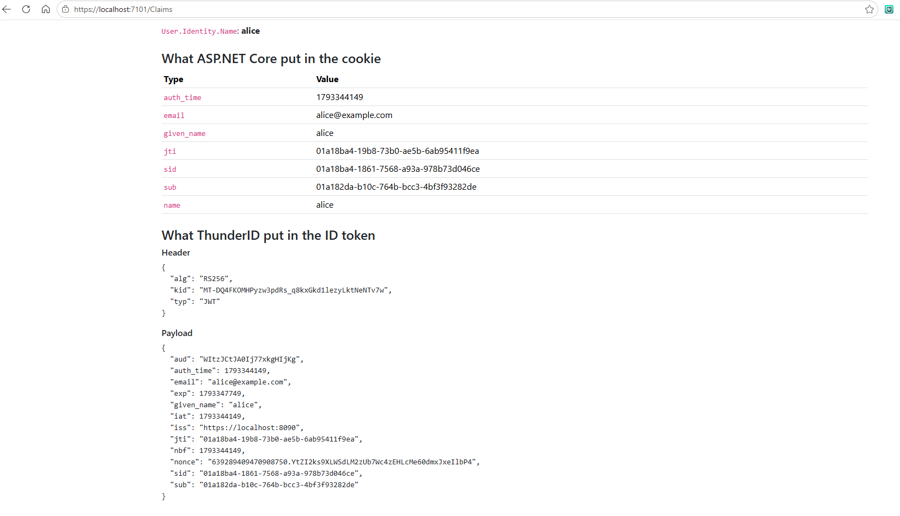

On the API side, the fix for the 403 is one line. `AddScopePolicy` splits the `scope` string
before checking it:

```csharp
builder.Services.AddThunderIDApi(options =>
{
    options.Authority = builder.Configuration["ThunderID:Authority"]!;
    options.Audience = builder.Configuration["ThunderID:Audience"]!;
});

builder.Services.AddAuthorizationBuilder()
    .AddScopePolicy("billing:read", "billing:read");
```

Same token, same user, and this time:

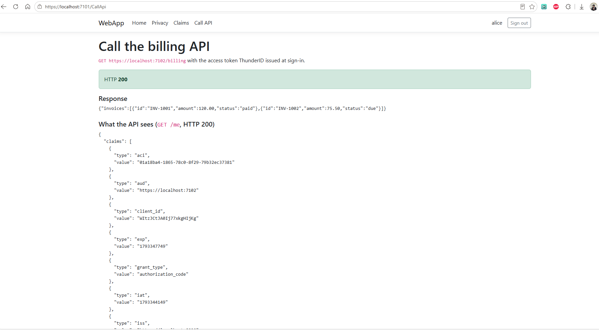

I wrote 22 tests for these helpers. The ones I care most about are the near misses. A token with
`billing` must not pass a check for `billing:read`, and a token with `billing:read` must not pass a
check for `billing`. Scopes are compared exactly, including case. There's also a test that
generates a hundred nonces and checks every one fits ThunderID's 64-character limit and still
carries a valid timestamp.

## Eight ways to reject a logout token

Now the real work: something that receives ThunderID's logout token and decides whether to trust
it. This matters more than it looks. The endpoint has no login and no cookie check, because
ThunderID calls it server to server. Anyone on the internet can POST to it. The only thing that
makes a request trustworthy is the token's signature and its claims. If the checks are sloppy,
an attacker can sign your users out, or worse, a leaked ID token could be passed off as a logout.

The spec (OpenID Connect Back-Channel Logout 1.0, section 2.6) lists the checks. ThunderID's own
SDK guidelines repeat them and say none of them may be switched off. Here they are, one line each:

1. **`typ` is `logout+jwt`.** An ID token says `JWT`, so it can't pass as a logout token.
2. **The signature verifies** against ThunderID's published keys (JWKS), with an algorithm it
   uses for ID tokens.
3. **`iss` matches exactly.** Even a trailing slash counts as a mismatch.
4. **`aud` contains my client ID.** A logout meant for another app is refused.
5. **`iat` and `exp` are in range**, with a small clock tolerance. These tokens live for two
   minutes.
6. **`events` has the back-channel logout member.** This is what says "this JWT is a logout".
7. **There is no `nonce`.** ID tokens carry a nonce, logout tokens never do. Checks 1, 6 and 7
   together are what stop an ID token being replayed as a logout token.
8. **`sid` or `sub` is present**, otherwise there's nothing to log out.

On top of that, I refuse a `jti` I've already seen, so a captured token can't be replayed.

I wrote the tests first, and they don't touch the network. The "valid" token in the tests is a
copy of the real one ThunderID sent my probe, same claims, same `sid`, same `iat`, just signed
with a test key. Then each rejection test breaks exactly one thing. There's a test that takes the
shape of a real ID token from my first sign-in (`typ: JWT`, a nonce, no events) and checks it gets
refused.

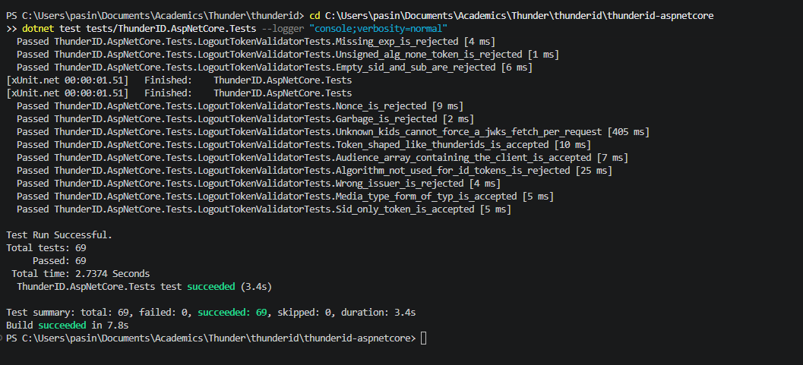

One test failed the first time, and it was a good catch. I sent a token with a key ID (`kid`) that
doesn't exist in ThunderID's JWKS, signed with ThunderID's real key. I expected a rejection. It
was accepted. By default, .NET's token handler ignores a `kid` it doesn't recognise and just tries
every key it has. The signature still had to be valid, so this wasn't a forgery hole. But it's
looser than it should be, and it hid a real problem: when ThunderID rotates its keys, a token with
a new `kid` is exactly the signal to fetch the JWKS again. Turning off
`TryAllIssuerSigningKeys` fixed both.

That refresh needs a limit too. The endpoint is public, so someone could send a thousand tokens
with made-up key IDs and make my app hammer ThunderID's JWKS endpoint. .NET's
`ConfigurationManager` already rate-limits refreshes, and there's a test for it: twenty tokens with
twenty unknown key IDs cause at most two JWKS fetches.

The second half is the session store. It only has two jobs: remember which sessions ThunderID
ended, and answer "has this session ended?" A token with a `sid` ends that one session. A token
with only a `sub` ends every session that user started *before* the token was issued, so if Alice
has already signed in again, her new session survives. The default store is in memory, which is
fine for one instance. With two or more instances behind a load balancer, the logout reaches only
one of them, so you'd plug in a shared store instead.

## You can't delete a cookie from the server

With a validator and a store in place, the endpoint itself is short. In the app it's one line,
replacing the probe from earlier:

```csharp
app.MapThunderIDBackchannelLogout("/backchannel-logout");
```

Behind that line, the endpoint follows ThunderID's SDK guidelines closely:

- **POST, form-encoded, one `logout_token`, body capped at 16 KB.** Anything else is a 400.
- **No login, no cookie, no antiforgery token.** ThunderID calls it server to server, and the
  token's signature is the only authentication.
- **200 when the token is valid**, even if it names a session this app never had. That way a
  repeated delivery is harmless.
- **400 when the token is bad**, with the name of the failed check, never the token itself.
- **500 only when the logout couldn't be recorded.** That's ThunderID's signal to retry.
- **`Cache-Control: no-store` on every response.**

I almost shipped a nasty bug here. My first version compiled fine:

```csharp
endpoints.MapPost(pattern, HandleAsync); // HandleAsync returns Task<IResult>
```

But `HandleAsync` takes only an `HttpContext`, so C# picked the `RequestDelegate` overload of
`MapPost`. That overload throws away whatever the method returns. Every 400 and every 500 would
have gone out as an empty 200, and ThunderID would never retry a failed logout. The only hint was
an analyzer warning, ASP0016. Casting it to a `Func<HttpContext, Task<IResult>>` fixed it. To make
sure my tests would have caught it too, I put the bug back on purpose: nine tests failed.

Then there's the part the section title is about. My app keeps its session in a cookie, and the
cookie lives in the user's browser. When ThunderID tells my server "session X has ended", my
server can't reach into that browser and delete anything. All it can do is remember, and refuse
the cookie the next time the browser sends it.

So the library hooks into the cookie handler's `OnValidatePrincipal` event, which runs on every
request:

```csharp
var store = context.HttpContext.RequestServices.GetRequiredService<ILogoutSessionStore>();
if (await store.IsSessionEndedAsync(sessionId, subject, authTime, context.HttpContext.RequestAborted))
{
    context.RejectPrincipal();
    await context.HttpContext.SignOutAsync(context.Scheme.Name);
}
```

`RejectPrincipal` makes this request anonymous. `SignOutAsync` tells the browser to drop the
cookie. The store has to remember an ended session for as long as a cookie could still be valid,
so the library sets its retention to the cookie's own expiry time.

This only covers my app's session. If my app had already passed Alice's access token to another
service, that token stays valid until it expires, up to an hour with ThunderID's defaults. Ending
a session doesn't recall tokens that are already out there.

## The moment it works

With the receiver in place, I ran the same test that failed back in the probe step. I signed in
as Alice in one browser window and opened her profile:

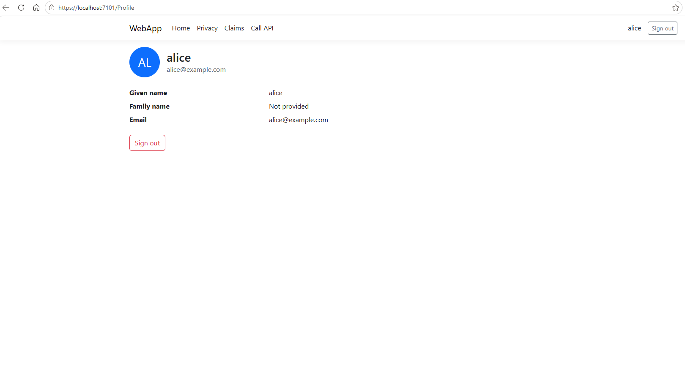

Then, in a second window, I opened ThunderID's logout URL. That window is "somewhere else": it
could just as well be a different tab or a different app. My app's sign-out button isn't
involved at all.

I went back to the first window and pressed F5. Instead of the profile, I got ThunderID's
sign-in page:

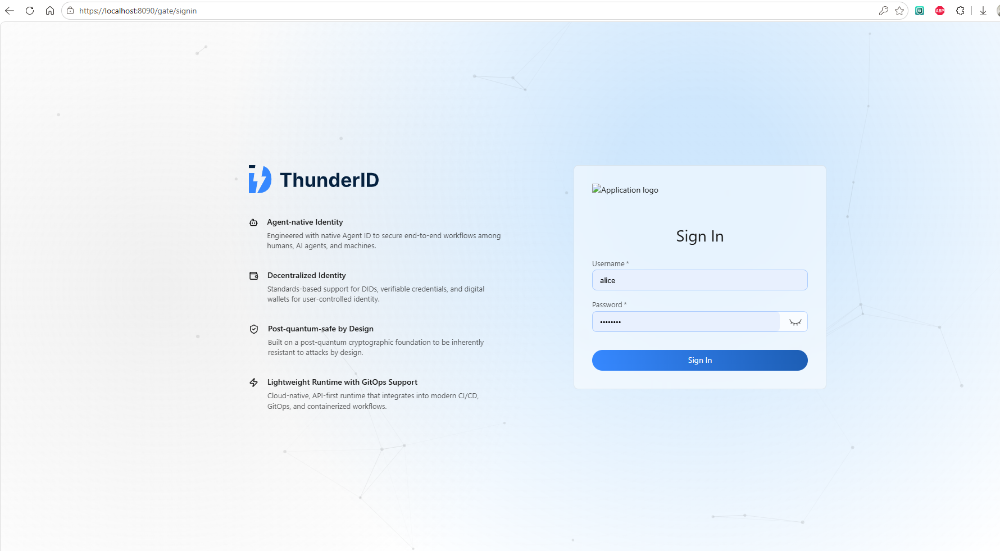

Here's what happened, from both logs side by side:

```text
15:43:42.152  ThunderID  POST /oauth2/logout/callback   session deleted
15:43:42.164  WebApp     POST /backchannel-logout       logout token arrives
15:43:42.213  WebApp     Back-channel logout recorded: sid 01a18c4c-...
15:43:42.215  WebApp     -> 200
15:43:48.056  WebApp     GET  /Profile                  (my F5)
15:43:48.059  WebApp     Refused a cookie session ended by back-channel logout
15:43:48.267  WebApp     -> 302 to ThunderID sign-in
```

The logout token reached my app 12 ms after ThunderID ended the session, and my app had
recorded it 61 ms after. Everything after that was waiting for me to press F5.

My first attempt at this demo didn't look like it worked, and it took me a few minutes to see
why. I had closed the first window before ending the session in the second one. Both windows
share the same cookie, so when ThunderID sent the second window back to my app, that window's
request was the one that got refused. The logout worked; it just happened in the window I
wasn't watching. The second time, I kept the first window open and only touched the second
one to log out.

## What this doesn't do

I want to be upfront about the edges, because a logout feature that quietly fails is worse than
none.

The store that remembers ended sessions lives in memory, in one process. That's fine for one
server. With two instances behind a load balancer, ThunderID's message reaches one of them, and
the other keeps accepting the cookie. A restart also forgets every logout it has seen. The store
is an interface, `ILogoutSessionStore`, so the fix is to back it with Redis or a database. I
didn't build that here.

Logout happens on the next request, not instantly. If Alice has the page open and doesn't click
anything, the page stays on her screen. The moment her browser talks to my server again, she's
out.

Access tokens that were already handed out stay valid until they expire. Back-channel logout ends
my web app's session. It doesn't tell my API anything.

And there's one thing I didn't test. ThunderID is built with post-quantum cryptography in mind,
so logout tokens signed with ML-DSA, the post-quantum signature algorithm, are a real
possibility. The build I used only offered RS256 and ES256, so every token I saw was RS256. The
version of Microsoft.IdentityModel I used (8.19.2) does include the ML-DSA algorithms, but I
haven't checked that it verifies a real ML-DSA logout token from ThunderID.

## What I'd tell you before you start

If you're connecting ASP.NET Core to ThunderID today, here's the short list:

- **Build ThunderID from `main`** if you want back-channel logout. No release has it yet.
- **Set the app's client authentication to `client_secret_post`.** .NET 9 uses PAR on its own and
  puts the secret in the request body.
- **Set `ResponseMode = "query"` and shorten the nonce** to 64 characters or less. Or use
  `AddThunderID()`, which does both.
- **Give the app a login flow with a session step**, or there's no `sid` and nothing to log out.
- **Map your scopes to user attributes in the console.** Empty mappings release nothing.
- **Don't use `RequireClaim("scope", ...)`** in an API. Split the scope string first.
- **Receive back-channel logout.** ThunderID already sends it. Your app just has to listen.

Most of these are one line of code or one setting. The hard part was finding them, and that's
what this article and the repo are for.

## What's next

This project used redirect-based login, the kind where the user leaves your app for ThunderID's
sign-in page and comes back. ThunderID also has an API for building the sign-in screens inside
your own app. The next thing I want to try is that, from Blazor, so the whole login stays inside
a .NET UI.

The code, the tests and a step-by-step quickstart are here:
https://github.com/pasindubalasooriya/thunderid-aspnetcore
